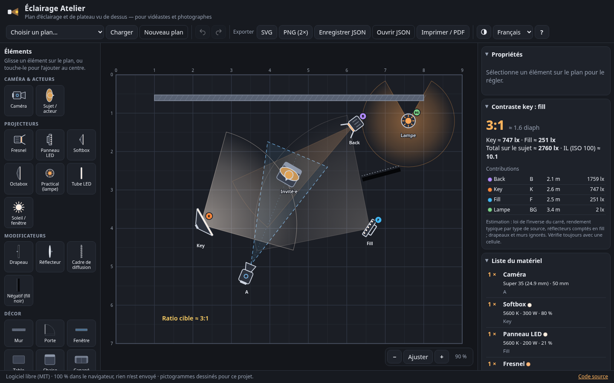
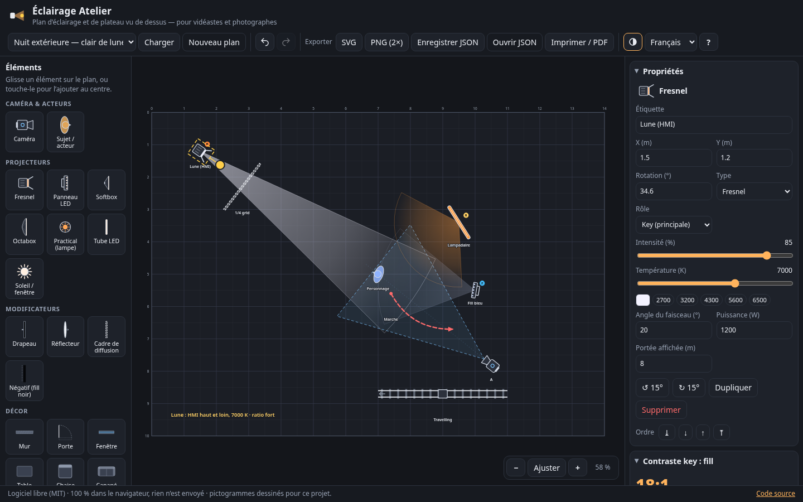
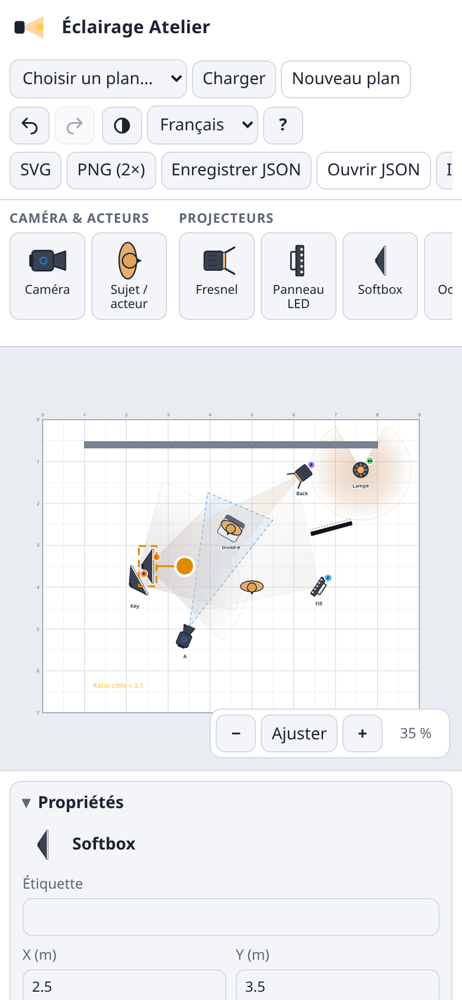
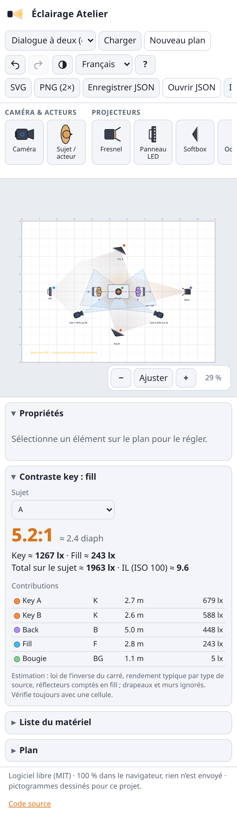

# Éclairage Atelier

**FR** — Outil gratuit pour dessiner des **plans d’éclairage et de plateau vus de dessus** (lighting plot), pour vidéastes, cinéastes et photographes, 100 % dans le navigateur. Place caméras (avec leur **vrai champ de vision** selon la focale et le capteur), acteurs, projecteurs (Fresnel, panneau LED, softbox, octa, practical, tube, soleil / fenêtre) avec faisceau, intensité et **température de couleur**, modificateurs et décor ; obtiens la **liste du matériel** et une **estimation du contraste key : fill**, puis exporte en **SVG**, **PNG 2×**, **JSON** ou **PDF**. Rien n’est envoyé à un serveur.

**EN** — Free **top-down lighting & set diagram planner** for filmmakers and photographers, fully in the browser. Place cameras (with a **real field-of-view cone** from focal length and sensor), actors, lights (Fresnel, LED panel, softbox, octa, practical, tube, sun / window) with beam angle, intensity and **colour temperature**, modifiers and set pieces; get an automatic **gear list** and a **key : fill ratio estimate**, then export **SVG**, **2× PNG**, **JSON** or **PDF**. Nothing is uploaded.

**Taqbaylit** — Afecku baṭel i usuneɣ n **uɣawas n tafat d usayes seg ufella**, i yimeskaren n tvidyutin, n yisura d yimsewwiren, akk deg yiminig. Sers tikamiratin (s wannar-nsent n tidet), imdanen, tifawin (Fresnel, LED, softbox, octa, lamba, aqettar, iṭij / ttaq) s tiɣmert, tazmert d tezɣelt n yini, imbeddlen d usayes ; ad tawiḍ tabdart n yiqeḍɛan d umgired key : fill, syin sifeḍ s SVG, PNG, JSON neɣ PDF. Ulac ayen ara yettwaznen.

👉 **Démo / Demo : https://salimadour31-boop.github.io/eclairage-atelier/**



## Fonctionnalités

- **Plateau** vectoriel (SVG) avec grille en mètres (pas 10 cm / 25 cm / 50 cm / 1 m, trait fort tous les mètres, règles), **zoom** (molette, boutons, pincement), **déplacement de la vue** (glisser le fond), **magnétisme** (Alt pour le désactiver pendant un glisser), taille du plateau réglable.
- **Palette** de 22 éléments, tous dessinés pour ce projet (SVG en ligne) — **glisser-déposer** sur le plan (souris, stylet ou doigt) ou simple clic / tap pour ajouter au centre :
  - **caméra** : focale (mm), capteur (Full Frame, Super 35, APS-C, Micro 4/3, Super 16, 1"), **cône de champ horizontal** calculé (2·atan(capteur / 2f)), longueur du cône ;
  - **sujet / acteur** avec direction du regard et couleur ;
  - **projecteurs** : Fresnel, panneau LED, softbox, octabox, practical, tube LED, soleil / fenêtre — angle de faisceau, intensité %, **température en K (faisceau teinté)**, puissance, portée affichée, étiquette, **rôle** (key, fill, back, rim, fond) affiché en pastille ;
  - **modificateurs** : drapeau, réflecteur, cadre de diffusion, négatif ;
  - **décor** : mur, porte (avec débattement), fenêtre, table, chaise, canapé ;
  - **rails de travelling**, **flèche de mouvement** (longueur, courbure, couleur) et **notes** texte.
- **Sélection, déplacement, rotation** (poignée jaune, pas de 15° avec magnétisme), dupliquer, supprimer, **ordre des calques** (premier plan, avancer, reculer, arrière-plan), **annuler / rétablir** (200 étapes), raccourcis clavier.
- **Panneau Propriétés** de l’élément sélectionné (champs adaptés au type, pastilles 2700 / 3200 / 4300 / 5600 / 6500 K).
- **Liste du matériel** automatique : nombre par type, regroupé par type + K + puissance, avec les intensités et les étiquettes, puissance totale.
- **Contraste key : fill** (rapport et diaphs, lux par source, IL à ISO 100) au niveau d’un sujet choisi — **estimation** : loi de l’inverse du carré, rendement typique (lm/W) de chaque type de source, angle solide du faisceau avec bord doux, réflecteurs comptés comme fill passif (Lambert) ; drapeaux et murs ignorés. Toujours à vérifier avec une cellule.
- **5 préréglages originaux** : interview 3 points, portrait Rembrandt, nuit extérieure / clair de lune, produit sur table, dialogue à deux (champ / contrechamp, règle des 180°).
- **Exports** : **SVG** (vectoriel, avec titre et échelle), **PNG 2×**, **JSON** (enregistrer / ouvrir, avec validation), **impression / PDF** via la boîte d’impression du navigateur (A4 paysage : page 1 le plan, page 2 la liste du matériel et le contraste).
- **Sauvegarde automatique** dans `localStorage` (plan, langue, thème).
- Interface **français / English / Taqbaylit**, thème **sombre / clair**, responsive (bureau, tablette, mobile : palette en bande défilante, panneaux repliables), aucune dépendance, aucune police ou ressource externe.



## Utilisation

1. Ouvre la [démo](https://salimadour31-boop.github.io/eclairage-atelier/) (ou sers le dossier en local, voir plus bas).
2. Choisis un **préréglage** ou **Nouveau plan**, règle la taille du plateau dans le panneau **Plan**.
3. Glisse les éléments de la palette sur la grille, fais-les tourner avec la poignée jaune, règle-les dans **Propriétés**.
4. Lis la **liste du matériel** et le **contraste key : fill**, puis exporte (SVG, PNG, JSON) ou imprime en PDF.

| Raccourci | Action |
|---|---|
| <kbd>Suppr</kbd> / <kbd>⌫</kbd> | supprimer la sélection |
| <kbd>Ctrl</kbd>+<kbd>D</kbd> | dupliquer |
| <kbd>Ctrl</kbd>+<kbd>Z</kbd> · <kbd>Ctrl</kbd>+<kbd>Y</kbd> (ou <kbd>Ctrl</kbd>+<kbd>Maj</kbd>+<kbd>Z</kbd>) | annuler / rétablir |
| <kbd>R</kbd> / <kbd>E</kbd> (<kbd>Maj</kbd> : 1°) | tourner de +15° / −15° |
| <kbd>←</kbd> <kbd>↑</kbd> <kbd>→</kbd> <kbd>↓</kbd> (<kbd>Maj</kbd> : 1 cm) | déplacer d’un pas de grille |
| <kbd>]</kbd> · <kbd>[</kbd> | avancer / reculer dans l’ordre |
| <kbd>+</kbd> <kbd>−</kbd> <kbd>0</kbd> | zoom avant / arrière / ajuster |
| <kbd>S</kbd> | magnétisme oui / non |
| <kbd>Échap</kbd> | désélectionner |
| <kbd>?</kbd> | aide |

<p>
  
  
</p>

## Structure

| Fichier | Rôle |
|---|---|
| `index.html` | Page et structure de l’interface |
| `style.css` | Thèmes sombre / clair, mise en page responsive, feuille d’impression |
| `js/core.js` | Cœur sans DOM : modèle, catalogue, champ caméra, couleur des K, estimation photométrique, liste du matériel, préréglages, validation JSON, historique |
| `js/render.js` | Rendu SVG (plateau, faisceaux, pictogrammes, export) — sans DOM |
| `js/i18n.js` | Traductions FR / EN / Taqbaylit |
| `js/app.js` | Interface : palette, glisser-déposer, sélection, rotation, propriétés, panneaux, exports, sauvegarde |
| `tests/unit.js` | Tests unitaires Node (aucun module requis) |
| `tests/e2e.js` | Tests Playwright (bureau 1440×900 et mobile 390×844) |

## Tests

```bash
node tests/unit.js
npm i playwright && npx playwright install chromium   # hors du dépôt si tu préfères
python3 -m http.server 8765 &
EA_URL=http://localhost:8765/ node tests/e2e.js        # SHOTS=1 pour régénérer les captures
```

Les tests de bout en bout vérifient notamment : glisser-déposer depuis la palette (souris et tactile), ajout au clic / tap, déplacement, rotation par poignée et clavier, dupliquer / supprimer / ordre, annuler / rétablir, les propriétés (focale → champ, capteur, intensité, K, rôle, type), désélection, déplacement et zoom de la vue (molette, pincement), les 3 langues, le thème, les 5 préréglages, les exports SVG / PNG 2× / JSON, l’import JSON (et le rejet d’un fichier invalide), la feuille d’impression et un vrai PDF, la persistance après rechargement, l’absence de débordement horizontal à 390 px et l’absence d’erreurs console.

## Licence

[MIT](LICENSE) — © 2026 Amirouche Amwanes (salimadour31-boop). Les corrections, surtout pour les traductions en taqbaylit (premier jet), sont bienvenues via issue ou pull request.
